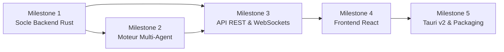

# 🗺️ MultiBot - Feuille de Route & Spécifications des GitHub Issues

Ce document recense l'ensemble des jalons (Milestones) et des tickets (Issues) prêts à être créés sur GitHub pour développer **MultiBot** en open source.

---

## 🏛️ Stack Technique Retenue

* **Backend & Moteur d'Agents** : **Rust** (Axum, Tokio, SQLx, Reqwest)
  * Performance native, sécurité mémoire, faible consommation VRAM/RAM.
  * Compatible serveur autonome, bureau et mobile via compilation cross-platform.
* **Frontend** : **React** (Vite, TypeScript, Tailwind CSS, Zustand, Lucide Icons)
  * Application Web réactive communiquant en REST + WebSockets.
* **Support Multiplateforme (Desktop & Mobile)** : **Tauri v2**
  * Embarque l'interface React avec le moteur Rust en binaire natif pour macOS, Linux, Windows, iOS et Android.
* **Persistance & Données** : **SQLite** embarqué (zéro configuration requise).

---

## 📌 Vue d'ensemble des Milestones

---

## Milestone 1 : Socle Backend & Moteur d'Exécution en Rust

### Issue #1 : Initialisation de l'espace de travail Cargo (Workspace)
* **Labels** : `backend`, `rust`, `setup`
* **Description** :
  Structurer le projet Rust sous forme de workspace Cargo modulaire pour séparer les responsabilités.
* **Tâches à réaliser** :
  - [ ] Créer `crates/multibot-core` (structures de données, logique agentique, traits).
  - [ ] Créer `crates/multibot-server` (serveur HTTP Axum, routes, WebSockets).
  - [ ] Créer `crates/multibot-tools` (exécution shell, gestion de fichiers, git).
  - [ ] Configurer `Cargo.toml` racine avec les dépendances partagées (Tokio, Serde, Tracing, Anyhow).

---

### Issue #2 : Couche de persistance SQLite avec SQLx
* **Labels** : `backend`, `rust`, `database`
* **Description** :
  Mettre en place la base de données SQLite embarquée pour stocker l'historique complet, les projets, les tâches et les configurations.
* **Tâches à réaliser** :
  - [ ] Configurer `sqlx` avec driver SQLite et pool de connexions asynchrones.
  - [ ] Écrire les migrations initiales :
    - `projects` (id, nom, description, mode_autonome, chemin_dossier, statut).
    - `tasks` (id, project_id, titre, description, statut, assigne_a, ordre, dependances).
    - `agent_logs` (id, project_id, task_id, agent_role, message, tokens_utilises, timestamp).
    - `model_providers` (id, nom, type_api, endpoint_url, api_key_encryptee, model_name).
  - [ ] Créer les fonctions de requêtage (CRUD) dans `multibot-core`.

---

### Issue #3 : Client LLM unifié et streaming agnostique
* **Labels** : `backend`, `rust`, `llm`
* **Description** :
  Développer un client HTTP en Rust capable de communiquer indifféremment avec Ollama en local et les API Cloud (Gemini, Claude, OpenAI) via une interface standardisée.
* **Tâches à réaliser** :
  - [ ] Définir un trait Rust `LlmProvider` avec méthode `complete(&self, req: LlmRequest) -> Result<LlmResponse>` et support du streaming `Stream<Item = String>`.
  - [ ] Implémenter le connecteur **Ollama** (`/api/chat` avec support local et streaming).
  - [ ] Implémenter le connecteur **Google Gemini** (Gemini 1.5 Pro / Flash).
  - [ ] Implémenter le connecteur **Anthropic Claude** (Claude 3.5 Sonnet).
  - [ ] Implémenter le connecteur compatible **OpenAI format** (v1/chat/completions).
  - [ ] Gérer les timeouts, les retries automatiques et l'extraction des Tokens.

---

### Issue #4 : Boîte à outils système (Sandbox, Fichiers & Git)
* **Labels** : `backend`, `rust`, `tools`
* **Description** :
  Fournir aux agents les "mains" pour manipuler le code, créer des projets et versionner avec Git.
* **Tâches à réaliser** :
  - [ ] Outil `read_file(path)` & `write_file(path, content)` sécurisés dans le dossier racine du projet.
  - [ ] Outil `list_directory(path)` et inspection de l'arborescence.
  - [ ] Outil `execute_command(command, args)` via `tokio::process::Command` avec timeout et capture stdout/stderr.
  - [ ] Outil `git_commit(message)` automatique après validation de chaque tâche pour historique infaillible.

---

## Milestone 2 : Moteur Multi-Agent & Orchestration Dynamique

### Issue #5 : Boucle d'état réactive (Event-Driven ReAct Loop)
* **Labels** : `backend`, `rust`, `agents`, `core`
* **Description** :
  Implémenter le moteur d'exécution non rigide qui permet aux agents d'analyser l'état du projet et de s'adapter aux imprévus.
* **Tâches à réaliser** :
  - [ ] Définir la machine à états d'une tâche : `Pending` ➔ `InReview` ➔ `InProgress` ➔ `Testing` ➔ `Done` ou `Failed`.
  - [ ] Gérer la détection des échecs : si l'exécution d'un test échoue, l'agent crée automatiquement une sous-tâche de debug au lieu d'interrompre le programme.
  - [ ] Boucle asynchrone non-bloquante exécutant les tâches prêtes en tâche de fond.

---

### Issue #6 : Rôle Agent Chef de Projet (Scrum Master)
* **Labels** : `agents`, `rust`
* **Description** :
  Créer l'agent responsable du cadrage, du découpage initial en tâches et du suivi d'avancement.
* **Tâches à réaliser** :
  - [ ] Prompt système spécialisé en décomposition de produit et gestion de dépendances.
  - [ ] Génération de structures JSON valides pour alimenter la table `tasks`.
  - [ ] Analyse dynamique de progression : recalculer les priorités si une étape s'est avérée plus complexe.

---

### Issue #7 : Rôle Agent Architecte & Interaction Contraintes
* **Labels** : `agents`, `rust`
* **Description** :
  Créer l'agent responsable de la conception logicielle qui soumet des choix techniques à l'utilisateur avant l'implémentation.
* **Tâches à réaliser** :
  - [ ] Analyse du besoin et proposition de stack (choix des bibliothèques, architecture de dossiers).
  - [ ] Émission de questions structurées pour l'utilisateur (ex: choix de base de données, préférences).
  - [ ] Rédaction du fichier de spécifications techniques (`SPEC.md`) du projet cible.

---

### Issue #8 : Rôles Agent Développeur & Agent Testeur (QA)
* **Labels** : `agents`, `rust`
* **Description** :
  Développer les agents exécutants qui génèrent le code réel et s'assurent de sa validité.
* **Tâches à réaliser** :
  - [ ] **Développeur** : Implémentation du code via les outils fichiers, gestion des imports et modules.
  - [ ] **Testeur (QA)** : Analyse du code écrit, génération de tests unitaires, exécution des commandes de vérification.
  - [ ] Rétroaction : le testeur renvoie les erreurs au développeur en cas d'échec pour correction immédiate.

---

### Issue #9 : Logique Human-in-the-Loop & Mode Autonome
* **Labels** : `agents`, `ux`
* **Description** :
  Gérer l'aiguillage des tâches entre l'utilisateur et l'IA en fonction de la disponibilité de l'utilisateur.
* **Tâches à réaliser** :
  - [ ] Si `mode_autonome == false` : le système notifie l'utilisateur pour chaque tâche prête et demande : *"Souhaitez-vous la coder ou déléguer à l'IA ?"*.
  - [ ] Si `mode_autonome == true` : l'IA enchaîne automatiquement toutes les tâches sans interruption.
  - [ ] Possibilité pour l'utilisateur de prendre la main à tout moment sur une tâche en cours.

---

## Milestone 3 : Serveur API & Communication Temps Réel

### Issue #10 : API REST avec Axum
* **Labels** : `backend`, `rust`, `api`
* **Description** :
  Exposer les routes nécessaires pour piloter le backend depuis l'interface Web ou mobile.
* **Tâches à réaliser** :
  - [ ] `POST /api/projects` : Créer un projet avec prompt d'objectif.
  - [ ] `GET /api/projects/:id` : Récupérer l'état, les tâches et les statistiques d'un projet.
  - [ ] `GET /api/projects/:id/tasks` & `PATCH /api/tasks/:id` : Modification ou assignation de tâche.
  - [ ] `POST /api/providers` : Enregistrement et test de connexion d'un modèle (Ollama / Cloud).
  - [ ] `GET /api/system/ollama-models` : Détection automatique des modèles locaux présents sur la machine.

---

### Issue #11 : Canaux WebSockets pour le streaming et les logs en direct
* **Labels** : `backend`, `rust`, `websockets`
* **Description** :
  Diffuser en temps réel les réflexions des agents, les modifications de fichiers et l'état des tâches.
* **Tâches à réaliser** :
  - [ ] Canal WebSocket `/ws/projects/:id`.
  - [ ] Émission d'événements typés : `AgentThinking`, `FileCreated`, `TaskUpdated`, `UserPromptRequired`.
  - [ ] Diffusion mot à mot (token streaming) des réponses des modèles d'IA.

---

## Milestone 4 : Interface Utilisateur React

### Issue #12 : Initialisation du Dashboard React (Vite + TS + Tailwind)
* **Labels** : `frontend`, `react`, `setup`
* **Description** :
  Mettre en place l'application frontend avec une architecture moderne, fluide et réactive.
* **Tâches à réaliser** :
  - [ ] Initialiser le projet avec Vite, React 19, TypeScript et Tailwind CSS.
  - [ ] Configurer un client WebSocket persistant avec reconnexion automatique.
  - [ ] Implémenter le store global avec Zustand (état du projet actif, logs, liste des tâches).

---

### Issue #13 : Tableau Kanban interactif & Timeline
* **Labels** : `frontend`, `react`, `ui`
* **Description** :
  Créer le tableau visuel montrant l'état des tâches du projet en temps réel.
* **Tâches à réaliser** :
  - [ ] Colonnes : *À faire*, *En cours (IA ou Utilisateur)*, *Validation/Tests*, *Terminé*.
  - [ ] Carte de tâche détaillée : badge de l'agent assigné, temps passé, sous-tâches, logs associés.
  - [ ] Possibilité pour l'utilisateur de cliquer sur *"Je m'en occupe"* pour s'attribuer une tâche.

---

### Issue #14 : Panneau de Chat et Live Feed des échanges entre agents
* **Labels** : `frontend`, `react`, `ui`
* **Description** :
  Interface de discussion permettant de voir les agents échanger entre eux et d'interagir directement.
* **Tâches à réaliser** :
  - [ ] Flux des messages avec filtre par agent (Chef de projet, Architecte, Dev, QA).
  - [ ] Affichage en streaming des réponses mot à mot.
  - [ ] Zone de saisie pour injecter des contraintes ou répondre aux demandes de l'équipe.

---

### Issue #15 : Gestionnaire de Modèles & Paramètres d'Autonomie
* **Labels** : `frontend`, `react`, `settings`
* **Description** :
  Écran de configuration permettant à n'importe quel utilisateur d'ajouter ses modèles facilement.
* **Tâches à réaliser** :
  - [ ] Formulaire de saisie d'URL Ollama locale avec bouton "Tester & Lister les modèles".
  - [ ] Formulaire pour clés API (Gemini, Claude, OpenAI) avec stockage chiffré/sécurisé.
  - [ ] Sélecteur de rôle : choisir quel modèle pilote quel agent.
  - [ ] Toggle global et par projet : *Mode 100% Autonome* vs *Mode Pair Programming*.

---

### Issue #16 : Explorateur de Fichiers & Visualiseur de Diff Git
* **Labels** : `frontend`, `react`, `ui`
* **Description** :
  Permettre à l'utilisateur d'inspecter en direct les fichiers créés par l'IA et de voir les modifications apportées.
* **Tâches à réaliser** :
  - [ ] Arborescence des fichiers du projet généré.
  - [ ] Visionneuse de code avec coloration syntaxique.
  - [ ] Vue "Diff" montrant les changements ligne par ligne faits par chaque tâche.

---

## Milestone 5 : Multiplateforme (Desktop, Mobile) & Déploiement

### Issue #17 : Packaging Desktop avec Tauri v2 (macOS, Windows, Linux)
* **Labels** : `tauri`, `desktop`, `rust`
* **Description** :
  Intégrer le frontend React et le backend Rust dans un exécutable desktop unique, léger et autonome.
* **Tâches à réaliser** :
  - [ ] Initialiser la configuration Tauri v2 dans le repo.
  - [ ] Lancer le serveur Axum / moteur d'agents en tant que processus enfant ou thread natif dans Tauri.
  - [ ] Configurer les permissions système (accès disque pour manipuler les projets).
  - [ ] Mettre en place la build GitHub Actions pour générer les `.dmg` (macOS), `.msi` (Windows) et `.AppImage` (Linux).

---

### Issue #18 : Adaptation Mobile (iOS / Android) avec Tauri v2
* **Labels** : `tauri`, `mobile`
* **Description** :
  Compiler l'application pour smartphone permettant de suivre ses projets et de valider les tâches à distance.
* **Tâches à réaliser** :
  - [ ] Configurer les cibles Android et iOS avec Tauri v2 CLI.
  - [ ] Adapter l'UI React au format mobile (design responsive, navigation tactile).
  - [ ] Mode client distant : possibilité de connecter l'application mobile à un serveur MultiBot distant (sur VPS/serveur maison).

---

### Issue #19 : Déploiement Serveur Docker en 1 Clic
* **Labels** : `devops`, `docker`, `open-source`
* **Description** :
  Fournir un moyen immédiat pour héberger le serveur MultiBot sur un VPS ou une machine dédiée.
* **Tâches à réaliser** :
  - [ ] Rédiger un `Dockerfile` multi-stage optimisé (build Rust statique + build React).
  - [ ] Rédiger un `docker-compose.yml` avec volume persistant pour SQLite et les dossiers projets.
  - [ ] Rédiger la documentation d'installation rapide (`docker-compose up -d`).

---

### Issue #20 : Documentation Open Source & CI/CD
* **Labels** : `documentation`, `ci/cd`, `community`
* **Description** :
  Préparer le dépôt GitHub pour l'accueil de la communauté open-source.
* **Tâches à réaliser** :
  - [ ] Rédiger un `README.md` percutant avec capture d'écran, schéma d'architecture et Quickstart.
  - [ ] Rédiger le guide de contribution `CONTRIBUTING.md`.
  - [ ] Mettre en place GitHub Actions : linter `cargo clippy`, tests unitaires Rust, linter ESLint/TypeScript.
